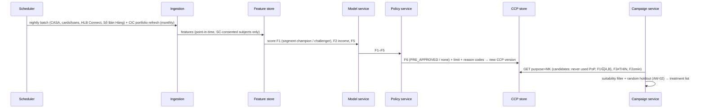
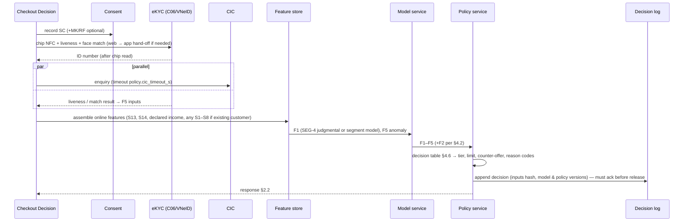

# Credit Assessment Engine — Detailed Design (HLB CreditPulse core)
**Product:** HLB Point-of-Purchase Credit Decisioning — **HLB CreditPulse** | **Document:** Skill 13 companion (13a), core-engine design | **Status:** Done (2026-10-01) | **Version:** 1.0
**Depends on:**
- `13-solution-design.md` §1 (CCP and tier policy) and §4 (architecture)
- `12-solution-proposal.md` §2 (method per component)
- `14-technical-feasibility.md`
- `17-user-stories.md` (part A: US-001 to US-036)
- `18-nfr.md`
- `19-data-requirements.md`
- `10-success-metrics.md`
- Skill 22 decisions D-01 to D-14

**Feeds into:** `23-product-prd.md` §4 (Solution Concept), engineering build of EP-0 and EP-7

> **Why this document exists.** The engine's design was spread across Skills 12, 13, 14, 17A and 19. This document consolidates it into one detailed specification of **how a customer is assessed**: inputs → features → models → the six profile fields → decision tier → explanation → learning loop → governance. It adds the parts no earlier file specified:
> - model targets;
> - scorecard construction;
> - challenger design and promotion rules;
> - income estimation;
> - evidence-confidence and integrity rules;
> - uplift design;
> - reason-code generation;
> - validation metrics;
> - the model lifecycle.
>
> **Evidence rule (unchanged).** No HLB number is invented. Thresholds, limits, windows and cut-offs are **named parameters set by HLB** (D-04), and §11 lists them all. Methods are cited: the literature review `[L#]`, research notes `[R#]`, and new method sources `[M#]` (Source Index at end). Upstream design decisions keep their IDs (DD-xx, A-13-x, US-xxx, NFR-xxx, DM-xx). Rubric tags: `[Rubric R2]` (AI value and viability), `[Rubric R3]` (data-to-decision architecture), `[Rubric R4]` (assumptions).

---

## 0. Scope and traceability

| Engine part | Skill 08 feature | Stories (Skill 17) | Data entities (Skill 19) | Components (Skill 14) |
|---|---|---|---|---|
| Consent gate | E-01 | US-021–023 | DM-04, DM-05, DM-36 | C-01 |
| Ingestion & features | E-02 (+E-03 Phase 2) | US-001–005, US-020 | DM-06, DM-07 | C-02, C-03, C-04 |
| Customer Credit Profile (CCP) | E-05 | US-006–009, US-018–019 | DM-08, DM-09 | C-14 |
| Models (risk, income, behavioural, early warning, uplift, integrity) | E-06 (+AW-03, PR-01, PR-02, AP-03) | US-010–013, US-210, US-220–222 | DM-10, DM-11 | C-05–C-11 |
| Policy & decision | E-07 | US-014–017 | DM-12, DM-17, DM-18 | C-12 |
| Refresh loop | E-08 | US-018–019 | DM-09 | C-03 |
| Explanation | E-09 | US-024–025 | DM-18 | C-13 |
| Governance | GV-01 | US-030–035 | DM-34, DM-35 | C-15, C-16 |

**Out of scope here.** These parts are specified in their own files:
- stage-service UX (Skill 13 §2);
- merchant integration (US-140–145);
- error copy (Skill 20);
- infrastructure sizing (Skill 18 §6).

---

## 1. Design principles `[Rubric R2]`

| # | Principle | Consequence in the design | Source |
|---|---|---|---|
| P-1 | **Consent first, per purpose** | Every feature computation and CCP read checks the scoring (SC), marketing (MK) or referral (RF) purpose. Fail closed | PDPL [Skill02 RF-7]; Decree 356 [Skill19 P2]; C1 |
| P-2 | **Data value before model value** | Invest first in bank-held behavioural signals. The ML challenger is added only where it beats the scorecard | ~⅔ of the alternative-data gain comes from data, not method [L9]; [Skill04 §5] |
| P-3 | **Rules where transparency matters** | The affordability cap, decision tiers, limits, stacking check and referral rewards are deterministic rules | AI Law human oversight and transparency [Skill02 RF-8]; DD-03, DD-08 |
| P-4 | **AI where evidence shows lift** | Thin-file risk precision, income estimation, behavioural re-scoring, uplift targeting and integrity anomalies | [L4][L18][L19][R49][L63] |
| P-5 | **Measure, don't assert** | A champion/challenger split, a randomised approval corridor and permanent holdouts are built in | [L36]; Skill 10 KR 2.1, 3.1, 3.4 |
| P-6 | **Explainable by construction** | Every decision carries reason codes from scorecard points or SHAP attributions. The decision log can replay it | [L24][L25][M1]; FM-10 |
| P-7 | **Responsible by default** | Affordability headroom gates every offer; graduation is offered, never applied automatically; anti-stacking applies at every draw; protected attributes are never inputs | [R30][R35][R36]; C2; DD-05, DD-07 |
| P-8 | **Portable and in-country** | Open-source, self-hostable components; no region-bound managed ML services | [Skill14 §4] (U-06, D-09) |

---

## 2. Engine context and interfaces `[Rubric R3]`

### 2.1 Position in the system
```
Stage services (Campaign · Package · Checkout Decision · Servicing · Recommendation · Referral · Case mgmt)
        │  CCP API (purpose-checked)                         ▲ events (decision, repayment, consent, campaign)
        ▼                                                    │
┌────────────────────────────── HLB CreditPulse ENGINE ─────────────────────────────────┐
│ Consent gate ─► Feature service (online/offline store) ─► Model service (scoring API)   │
│        │                                                     │                          │
│        └──────────────► Policy & Decision service ◄──────────┘                          │
│                              │ CCP F1–F6 + reason codes + versions                      │
│                              ▼                                                          │
│                        CCP store (current + history)  ──► Decision log (append-only)    │
│ Governance: model registry · monitoring (PSI, fairness, performance) · parameter store  │
└─────────────────────────────────────────────────────────────────────────────────────────┘
        ▲ batch + stream ingestion: HLB core banking · cards/loans · HLB Connect · Sổ Bán Hàng · CIC · checkout
```

### 2.2 CCP API contract (logical; field names normative, transport per Skill 14)

**`POST /ccp/assess`**: build or refresh a CCP for an application (Lane B), or re-validate one at checkout (Lane A). Called by the Checkout Decision service (US-009, US-112).
```json
{
  "request_id": "uuid (idempotency key)",
  "purpose": "SC",
  "subject": { "customer_key": "uuid | null", "applicant_id": "uuid | null" },
  "context": {
    "channel": "WIDGET | HOSTED | QR | APP",
    "merchant_id": "string",
    "basket_vnd": 0,
    "requested_tenors": [3, 6, 9, 12, 18, 24],
    "declared_monthly_income_vnd": 0,
    "ekyc_result_ref": "uuid",
    "device_class": "string"
  }
}
```
Response:
```json
{
  "ccp_version_id": "uuid",
  "f1": { "grade": "A|B|C|D|E", "pd_band": "string", "source_model": "CHAMPION|CHALLENGER", "model_version": "string" },
  "f2": { "headroom_vnd_per_month": 0, "income_estimate_vnd": 0, "income_ci_vnd": [0, 0], "f2_status": "OBSERVED|DECLARED_INCOME|CIC_OBLIGATIONS_UNKNOWN|NO_INCOME_EVIDENCE" },
  "f3": { "evidence": "BUREAU+BANK|BANK-OBSERVED|CONSENTED-PARTNER|THIN", "sources": ["S1", "S14"] },
  "f4": { "suitable": true, "uplift_score": null, "top_categories": [] },
  "f5": { "integrity_score": 0, "flags": [] },
  "f6": { "tier": "PRE_APPROVED|INSTANT_APPROVE|REFER|DECLINE", "limit_vnd": 0, "corridor": false, "counter_offer": null, "reason_codes": ["R-xx"] },
  "cic_status": "OK|CACHED|UNAVAILABLE",
  "policy_version": "string",
  "decision_id": "uuid",
  "latency_ms": 0
}
```

**`GET /ccp/{subject}?purpose=SC|MK|RF`**: read the current CCP (all stage services). A purpose without matching consent returns `403 CONSENT_REQUIRED` and writes DM-36 (US-008).

**Events published:**
- `ccp_refreshed`
- `decision_returned`
- `evidence_confidence_upgraded`
- `early_warning_flagged`
- `early_warning_cured`

These feed Skill 19 §5.

**Latency budgets** [Skill18 NFR-PERF-02]: submit → decision p50 ≤ 8 s, p99 ≤ 20 s. The CIC call runs in parallel with liveness, with a hard timeout of `policy.cic_timeout_s`. The scoring API must stay at p95 ≤ 200 ms.

---

## 3. Data inputs and feature engineering `[Rubric R3]`

### 3.1 Feature-store rules
- **Point-in-time correctness.** Every feature carries `event_ts` and is joined "as of" the observation time, both for training and for online serving [M6].
- **Usage tags** (DM-06), enforced by the training pipeline and the model registry (US-005):
  - `model_input`: may enter risk models.
  - `propensity_only`: S12; may enter propensity or uplift models only.
  - `fairness_monitoring_only`: gender, age band, region, `referred_by_customer`. Never a model input.
- **Windows.** Feature windows use named parameters (`feature.window_short_months`, `feature.window_long_months`), defaulting to the 6- and 12-month windows already referenced in Skill 13 S1. A minimum-history rule (`ccp.bank_observed_min_months`) decides whether a CASA history counts as BANK-OBSERVED.
- **Missing values** are explicit. Each feature has a `missing_reason` (NO_ACCOUNT, NO_CONSENT, SOURCE_STALE, NOT_APPLICABLE). The scorecard bins a missing value as its own attribute (§4.1.3); it is never imputed silently.

### 3.2 Feature specifications (signals S1–S17 → engineered features)

Notation: inflows = credits to the customer's HLB current/savings (CASA) accounts, **excluding** own-account transfers and loan disbursements (A-13-1). `m` = calendar month.

| Signal | Engineered features (examples, all `model_input` unless noted) | Formula / rule | Window | Source & availability |
|---|---|---|---|---|
| **S1 Inflow regularity** | `inflow_months_active`, `inflow_cv`, `inflow_median_vnd`, `inflow_trend_slope` | count of months with ≥1 qualifying inflow; coefficient of variation = σ/μ of monthly inflow totals; median of monthly totals; OLS slope of monthly totals ÷ median | short and long | CASA (confirmed source) |
| **S2 Salary-day stability** | `main_payer_share`, `payday_dom_sd`, `payday_hit_rate` | share of inflow from the largest recurring payer; standard deviation of that payer's day-of-month; share of months with that payer's credit | long | CASA; payer identification = **A-13-1 (spike SP-1)** |
| **S3 Pre-payday buffer** | `prepay_min_balance_ratio`, `negative_days` | min balance in the 5 days before the main inflow ÷ average monthly outflow; days with balance < 0 or overdraft | short | CASA |
| **S4 Platform-payout signature (gig)** | `platform_payout_weeks_active`, `platform_payout_cv`, `payout_weekday_mode`, `payout_weekday_stability` | weeks with a platform credit; CV of weekly payouts; most frequent weekday; share of payouts on that weekday | short | CASA payouts from known platforms (counterparty list) — **A-13-2** |
| **S5 Sales-flow signature (MSME)** | `sales_monthly_median_vnd`, `sales_cv`, `sales_trend`, `refund_ratio`, `qr_receipt_days`, `einvoice_total_vnd` | as S1 on Sổ Bán Hàng daily sales + QR/transfer receipts; refunds ÷ sales; e-invoice totals | short and long | Sổ Bán Hàng (`source:SBH` consent) + CASA [R66] |
| **S6 Bill-payment punctuality** | `bills_paid_count`, `bills_on_time_share` | utility/telco/school bill payments from CASA; share paid on or before due date | long | CASA bill-pay — **A-13-3** |
| **S7 Wallet top-up rhythm** | `wallet_topup_months_active`, `wallet_topup_cv` | months with CASA → e-wallet transfers; CV of monthly top-ups | short | CASA counterparty — **A-13-2** |
| **S8 Savings discipline** | `savings_transfer_months`, `savings_share_of_inflow` | months with transfers to savings or term deposits; total ÷ total inflow | long | Deposits |
| **S9 Spend mix** | `essential_share`, `spend_cv`, `top_categories` | spend in essential merchant categories ÷ total spend; CV of monthly spend; top 3 categories (`propensity_only` for categories) | short | Cards / QR — **A-13-4** |
| **S10 HLB credit conduct** | `hlb_max_dpd_12m`, `hlb_utilisation_avg`, `hlb_ontime_share` | worst days past due; average card utilisation; on-time instalment share | long | HLB loans / cards |
| **S11 Relationship stability** | `tenure_months`, `products_held`, `kyc_change_recent` | months since the customer record (CIF) was opened; product count; change of phone or address within `integrity.kyc_change_window_days` (used by F5) | — | Core banking |
| **S12 Digital engagement** | `app_login_days_30`, `selfservice_use` | **`propensity_only`**: never in risk models (DD-07) | short | HLB Connect |
| **S13 Checkout footprint** | `device_os_class`, `hour_of_day_bucket`, `email_domain_class`, `phone_tenure_flag`, `basket_category`, `downpayment_share` | categorical buckets; no contacts or gallery (X-01) | at application | Merchant + application (SC consent) [L1][R80] |
| **S14 CIC file** | `cic_has_file`, `cic_active_loans`, `cic_lenders_count`, `cic_max_dpd_24m`, `cic_monthly_obligation_vnd`, `cic_enquiries_recent` | parsed CIC report; raw payload kept for ≤ 30 days (A-18-1) | at decision; monthly portfolio refresh | CIC |
| **S15 PoP repayment behaviour** | `pop_ontime_share`, `pop_days_early_avg`, `pop_partial_count`, `pop_instalments_paid` | from the PoP loan ledger | rolling | HLB ledger |
| **S16 Cross-bank inflows (Phase 2)** | the S1/S2 feature set on other-bank data | as S1/S2 | 180-day access window [R73] | Open API (`source:OPENAPI:<bank>`) — Should |
| **S17 Telco / e-wallet / platform (Phase 3)** | not designed in v1 | — | — | Parked, PL-01 |
| **Application** | `declared_monthly_income_vnd`, `requested_amount_vnd`, `tenor` | as entered; declared income is never a risk feature on its own. It is used only in F2_thin and in an F5 plausibility check (EC-17) | — | Lane B form (US-111) |

### 3.3 Feature registry entry (DM-06), required fields
`feature_name`, `version`, `owner`, `source_signal` (S#), `formula_ref`, `window`, `usage_tag`, `pii_class` (Skill 19 §4), `missing_reasons[]`, `monotone_direction` (+1 / −1 / 0, used by the challenger, §4.1.4), `approved_by_MR` (bool), `effective_from`.

---

## 4. Profile field specifications (F1–F6) `[Rubric R2][Rubric R3]`

### 4.1 F1 — Risk Grade (A–E)

#### 4.1.1 Target definition
- **Bad** = the loan reaches `model.bad_definition_dpd` days past due within `model.performance_window_months` of booking. The default is aligned to Skill 10 guardrail G-1 (30+ days past due at MOB3), so model target and monitoring use the same outcome.
- **Good** = performing through the window. **Indeterminate** (window not yet elapsed, or early settlement before the window ends) is excluded from training. A *confirmed fraud* loan is labelled for the F5 integrity model, not as a credit bad.
- **Unit:** one PoP loan (first or repeat). Repeat loans carry the behavioural features S15.

#### 4.1.2 Segmentation (one champion per segment)
| Segment | Population | Champion at launch | Rationale |
|---|---|---|---|
| SEG-1 | F3 = BUREAU+BANK (mostly SAL-C, existing customers) | Data-driven scorecard on HLB history + CIC (S1–S3, S8–S11, S14) | Labels exist from HLB's existing lending |
| SEG-2 | F3 = BANK-OBSERVED, no CIC file (SAL-N, GIG paid into HLB) | Scorecard on CASA behaviour (S1–S8, S11) | CASA history is HLB-only [R71] |
| SEG-3 | F3 = CONSENTED-PARTNER (MSME via Sổ Bán Hàng) | Scorecard on sales flow S5 + S1 | Brief Exhibit 1: sales histories, recurring cash inflows [Brief p.8] |
| SEG-4 | F3 = THIN (new-to-bank, no CIC) | **Judgmental (expert) scorecard**: S13, S14 (if any), declared income, eKYC/integrity, conservative starter limits. Replaced by a data-driven scorecard once corridor outcomes reach `model.min_bads_for_training` | No historical approvals exist to learn from (cold start, B-04). Reject inference does not fix this reliably [L20] |

*Data sufficiency for SEG-1 to SEG-3 at launch depends on HLB's existing loan history. If it is insufficient, the same judgmental-start → corridor → data-driven path applies (spike SP-1, OQ-13A-01).*

#### 4.1.3 Champion — logistic scorecard (Weight-of-Evidence)
1. **Fine and coarse classing.** Bin each candidate feature. Missing is its own bin. Bins must be monotone in bad rate where the risk logic says so.
2. **Weight of Evidence.** For bin *i*: WoE*i* = ln(%good*i* / %bad*i*). Information Value: IV = Σ (%good*i* − %bad*i*) × WoE*i*. Features with IV below `model.iv_min` or above `model.iv_leakage_max` are dropped or investigated [M2].
3. **Logistic regression** on WoE-transformed features. Stepwise or regularised selection, reviewed for business sense. Correlated features are pruned.
4. **Points scaling.** Score = Offset + Factor × ln(odds_good), where Factor = PDO / ln 2 and Offset = Target_score − Factor × ln(Target_odds). The attribute points are the per-bin contributions [M2]. Parameters: `model.scorecard_pdo`, `model.scorecard_target_score`, `model.scorecard_target_odds`.
5. **Calibration.** Map score → PD on an **out-of-time** sample. Check calibration by score band.
6. **Explainability.** Reason codes are the attributes with the largest points shortfall versus the maximum attainable for that characteristic (§6).

*Why a scorecard as champion:* benchmarks show ensembles beat logistic scorecards only modestly [L18][L19]. A scorecard is transparent and quick to validate, which suits AI Law human oversight [Skill02 RF-8].

#### 4.1.4 Challenger — gradient-boosted trees (US-011)
- **Model class.** Gradient-boosted decision trees (XGBoost/LightGBM class) on the same consented features, plus raw (non-WoE) continuous features. **No deep learning**: no accuracy gain over GBM in credit-scoring benchmarks [L19].
- **Monotonic constraints.** Every feature with `monotone_direction` ≠ 0 in the registry is constrained, for example more on-time bills → never higher risk [M5]. This keeps the challenger's behaviour defensible and its explanations consistent.
- **Explanation.** TreeSHAP attributions per decision [M1][L24] feed the same reason-code catalogue (§6).
- **Calibration.** Same PD calibration and the same grade bands as the champion, so tiers are comparable.

#### 4.1.5 Grade bands
Calibrated PD → grade via `policy.grade_pd_cutoffs` (A best … E worst), set by the CRO. Grades drive the rate grid, `policy.grade_limit_vnd` and the tier rules (§4.6).

#### 4.1.6 Champion/challenger operation and promotion (KR 2.1)
- **Assignment.** For each segment, a random `governance.challenger_split_pct` of eligible decisions is graded by the challenger and the rest by the champion. Assignment is logged in the decision record.
- **Promotion rule (per segment), all of:**
  - (a) the challenger's out-of-time Gini/AUC beats the champion's by ≥ `governance.promotion_min_gini_uplift`;
  - (b) MOB3 30+ on challenger-decided loans is no higher than the champion's plus `governance.challenger_mob3_tolerance`;
  - (c) the approval-rate ratio across monitored groups is ≥ 0.8 (G-5);
  - (d) PSI is stable (§7);
  - (e) Model Risk signs off.
- **Rollback.** A drift breach (PSI > `model.psi_action_threshold`) or a guardrail breach reverts the segment to the champion within ≤ 5 min [Skill18 AI NFR].
- *This is how CreditPulse proves AI's incremental value per segment, as the brief requires [Brief pp.10–11].*

#### 4.1.7 Behavioural re-scoring (PR-01, US-220)
- **v1.** A behavioural scorecard for customers with ≥ 1 PoP instalment due. Features are S15 + S10 + refreshed S1–S3. It is recomputed on every repayment event and in a monthly batch, and replaces the application grade once `model.behavioural_min_instalments` instalments are observed.
- **Later.** Survival / time-to-default modelling, which predicts *when* default happens rather than only *if*, once enough PoP histories exist [M3]. Nubank uses survival curves with risk ranking for limit decisions [Skill12 N1].

### 4.2 F2 — Affordability Headroom (VND/month)

**Rule-based, with an estimated income input (DD-03).** The cap is deliberately transparent.

**Step 1: income estimate, by evidence path**

| Path | Applies when | Income estimate |
|---|---|---|
| I-1 Salaried (identified payer) | S2 identifies a recurring main payer | median monthly credit from the main payer over the long window |
| I-2 Irregular inflows (gig, mixed) | S1 shows inflows but no stable payer | the `policy.income_quantile` quantile of monthly inflow totals over the short window × (1 − `policy.income_volatility_haircut` × min(1, `inflow_cv`)) |
| I-3 Merchant sales (MSME) | S5 present (`source:SBH`) | median monthly sales × `policy.msme_income_from_sales_ratio`, a sales → disposable-income conversion set by HLB (new parameter, OQ-13A-02) |
| I-4 Cross-bank (Phase 2) | S16 present | as I-1 or I-2 on other-bank data |
| I-5 THIN (declared) | none of the above | min(declared_monthly_income × `policy.declared_income_haircut`, `policy.thin_headroom_cap_vnd`), per D-06 |
| ML refinement (US-012) | I-1 to I-4 | The ML stable-income estimator predicts a lower-bound next-3-month monthly inflow. It **replaces** the rule estimate only for segments where back-tests show lower error; otherwise the rule estimate stands |

**Step 2: obligations.** `obligations` = CIC-reported monthly instalments (S14) + HLB internal obligations + active PoP instalments. If CIC is unavailable and no cache under `policy.cic_cache_max_age_days` exists, `f2_status = CIC_OBLIGATIONS_UNKNOWN`; the tier then follows `policy.cic_fallback_mode` (D-07: REFER).

**Step 3: headroom**
```
headroom = max(0, min( policy.dsr_cap × income − obligations ,
                       income − obligations − policy.living_cost_buffer_vnd ))
```
*This clarifies Skill 13's "× DSR cap" wording, which Skill 17A OQ flagged as ambiguous. The binding constraint is whichever of the two limits is lower.*

**Step 4: schedule conversion.** For weekly schedules (PR-05), the affordability check compares the weekly instalment × `repayment.weeks_per_month_factor` against headroom (US-231 AC 4).

**Hard rule G-4.** No package or approval may have an instalment above headroom. Zero breaches are allowed.

### 4.3 F3 — Evidence Confidence (rules)
Evaluated in the order set by `ccp.f3_precedence`:
1. **BUREAU+BANK**: `cic_has_file` AND CASA history ≥ `ccp.bank_observed_min_months`.
2. **BANK-OBSERVED**: CASA (or Phase-2 cross-bank) inflow history ≥ `ccp.bank_observed_min_months`, with no CIC file.
3. **CONSENTED-PARTNER**: Sổ Bán Hàng data under `source:SBH` consent for ≥ `ccp.bank_observed_min_months`, and not stale (≤ 48 h, Skill 18 §5.2).
4. **THIN**: otherwise.

**Downgrades.** A consent withdrawal, or a stale source, re-evaluates F3 immediately. An upgrade from THIN emits `evidence_confidence_upgraded` (KR 2.3).

### 4.4 F4 — Propensity & Need
- **v1, suitability (AW-02, rules).** Eligible only if all hold:
  - MK consent;
  - no active early-warning flag;
  - anti-stacking pass (`policy.stacking_concurrent_consumer_loans_threshold`, `policy.stacking_rising_obligations_rule`);
  - no hardship within `policy.recent_hardship_lookback_days`;
  - headroom ≥ `policy.min_package_instalment`.

  `top_categories` come from S9 (`propensity_only`) and past PoP baskets.
- **Should, uplift (AW-03, US-210).**
  - **Treatment:** an offer was delivered. **Control:** the random holdout (`campaign.holdout_share`).
  - **Outcome:** a *good* PoP loan within `campaign.attribution_window_days`, i.e. booked and current at MOB3. This aligns uplift with the North Star rather than raw take-up.
  - **Method:** T-learner or X-learner meta-learners [M4]. X-learner is preferred when the treated and control groups are very unequal in size.
  - **Evaluation:** Qini / uplift curves [L63]. Targeting uses the top uplift deciles that pass suitability [R49][L62].

### 4.5 F5 — Identity & Application Integrity (0–100)
- **Hard rules** (any → `policy.integrity_floor` breach):
  - eKYC face/NFC mismatch beyond the retry cap;
  - CIC identity mismatch;
  - the same device or identity used across more than `integrity.velocity_rules` applications;
  - more than `integrity.eligibility_checks_per_24h` eligibility checks.
- **Soft signals** (weighted penalties, weights = `integrity.signal_weights`):
  - recent KYC contact change (`integrity.kyc_change_window_days`);
  - declared income above `policy.declared_income_plausibility_cap` relative to the segment (EC-17);
  - device-class / channel anomalies;
  - the unsupervised anomaly score.
- **Anomaly component.** An Isolation-Forest-class unsupervised detector [M7] runs over the application and device feature vector. At launch there are no fraud labels, so it contributes a bounded penalty. A supervised model replaces it once `fraud_confirmed` labels (G-2) accumulate.
- **Score.** `integrity = 100 − Σ soft penalties`, floored at 0. A hard-rule hit forces REFER, or DECLINE if the mismatch is confirmed. Flags go to the decision log only; they are never shown to customers or merchants (C-4).

### 4.6 F6 — Decision Tier, limit and counter-offer (Policy & Decision service)

**Ordered decision table** (first match wins) [Skill13 §1.1, as confirmed by Skill 22 D-06]

| # | Condition | Tier | Reason code(s) |
|---|---|---|---|
| 1 | F5 hard flag, or score < `policy.integrity_floor` | REFER (identity review); DECLINE if the mismatch is confirmed | R-ID-01 / R-ID-02 |
| 2 | `f2_status = CIC_OBLIGATIONS_UNKNOWN` and no valid cache | per `policy.cic_fallback_mode` (REFER) | R-SYS-01 |
| 3 | headroom < cheapest package instalment (`policy.min_package_instalment`) | DECLINE, with path message | R-AFF-01 |
| 4 | CIC stacking check fails | REFER if F1 ∈ {A,B}, else DECLINE | R-OBL-01 |
| 5 | F1 ∈ {A,B} and F3 ∈ {BUREAU+BANK, BANK-OBSERVED, CONSENTED-PARTNER} | PRE-APPROVED (batch, Lane A) / INSTANT-APPROVE (checkout) | — |
| 6 | F1 ∈ {A,B,C} and F3 = THIN | INSTANT-APPROVE at starter limit | R-LIM-01 (starter) |
| 7 | F3 = THIN, marginal band (`policy.corridor_band`), random draw < `policy.corridor_share` | INSTANT-APPROVE at starter limit, flagged CORRIDOR | R-LIM-01 |
| 8 | F1 = C (non-THIN), or F1 = D (non-THIN) | REFER (OP-01), with an immediate counter-offer if one exists | R-RSK-01 |
| 9 | otherwise | DECLINE | top reason codes (§6) |

**Limit.** For an approval with grade *g*, rate *r_g* (from the grid) and tenor *n*:
```
affordable_principal(n) = headroom × AF(r_g, n)        # AF = present-value annuity factor of n monthly payments
limit = min( policy.grade_limit_vnd[g], policy.max_financed_vnd, max_n affordable_principal(n) )
starter limit (rows 6–7) = min( policy.starter_limit_vnd, limit )
```
This makes Skill 13's "F2 headroom × tenor-adjusted factor" precise (`policy.tenor_adjusted_factor` = AF). It also guarantees G-4 by construction.

**Counter-offer (REFER rows).** Search packages over tenors {3,6,9,12,18,24} [Brief p.9] and down-payment options. Pick the package that:
- has instalment ≤ headroom;
- finances ≥ `policy.counter_offer_min_share` of the basket;
- has the lowest total cost.

If none qualifies, no counter-offer is made (US-124).

**Package build** (consumed by CO-01). Every package satisfies the limit and G-4, is priced from the risk-tier grid (no willingness-to-pay pricing, DD-10), and carries an all-in cost disclosure hash (US-106–107).

---

## 5. Assessment flows `[Rubric R3]`

### 5.1 Lane A: nightly pre-approval (DF-1)


### 5.2 Lane B: real-time checkout assessment (DF-2), target p50 ≤ 8 s system time after submit


### 5.3 Continuous reassessment on repayment (DF-3)
`repayment_recorded` (CBS) → S15 update → behavioural refresh (§4.1.7) → new CCP version. Then:
- **Graduation.** If on-time instalments ≥ `policy.graduation_on_time_instalments_N`, F2 is refreshed, and the CIC stacking check is clean, `policy.graduation_step_ladder` creates an **offered** step (never auto-applied), valid for `policy.graduation_offer_validity_days` (US-226–227).
- **Early warning.** Rule triggers (`ew.trigger_rules`) are evaluated:
  - (i) a missed or partial instalment;
  - (ii) a new CIC obligation;
  - (iii) an inflow drop beyond `ew.inflow_drop_threshold` versus the trailing median;
  - (iv) the balance falling below the next instalment ahead of the due date.

  A trigger raises `early_warning_flagged`. This **suppresses** marketing, graduation and pre-approval, and starts supportive outreach that follows PR-06 conduct rules. The flag clears per `ew.clear_after_on_time_cycles` (D-07 / BD-20-23).

### 5.4 Refresh triggers (E-08)
The CCP refreshes on any of these:
- a repayment event;
- a salary or main-payer inflow;
- a new CIC obligation (monthly refresh);
- a consent change;
- a source added or removed;
- the nightly batch.

A CCP older than `ccp.max_staleness` cannot be used for a decision, and is rebuilt on demand.

---

## 6. Explanation and reason codes (E-09) `[Rubric R2]`
- **Champion.** Rank characteristics by points shortfall = (max attainable points − points received). The top `reason_codes.display_count` map to codes.
- **Challenger.** Rank features by negative TreeSHAP contribution [M1], grouped to the same characteristic families, so reason codes look the same whichever model decided [L24][L25].
- **Policy reasons** (affordability, obligations, identity, system) come straight from the decision-table row (§4.6).
- **Customer copy.** Shown in Vietnamese per Skill 20 C-1 to C-9. Integrity or fraud signals are never disclosed (C-4). Merchants see only the status (C-5).

**Reason-code catalogue (v1, extendable via DM-18):**

| Code | Family | Customer-facing meaning (draft) | Path message |
|---|---|---|---|
| R-AFF-01 | Affordability | Instalment exceeds what your income comfortably covers | Smaller basket / larger down-payment / longer tenor |
| R-OBL-01 | Existing obligations | Existing loans are high relative to income | Reduce existing debt first |
| R-HIS-01 | Credit history | Limited credit history | A starter limit or HLB account helps build history |
| R-HIS-02 | Credit history | Recent late payments on file | On-time payments improve future decisions |
| R-INC-01 | Income evidence | Income inflows are irregular or too recent | More months of account history help |
| R-STB-01 | Stability | Recent changes in account or contact details | — |
| R-LIM-01 | Limit | Approved at a starting limit that grows with on-time repayment | Repay on time to unlock higher limits |
| R-RSK-01 | Overall risk | Needs a quick review by our team | Wait for the review, or take the counter-offer |
| R-ID-01 / R-ID-02 | Identity | We need to check a few details / we couldn't verify identity | Contact HLB |
| R-SYS-01 | System | We need a little longer (system or bureau unavailable) | Wait for the review |

---

## 7. Model lifecycle and validation (GV-01) `[Rubric R2][Rubric R4]`

### 7.1 Development standard
- **Splits.** Development, then out-of-time validation, then (after launch) live monitoring. No random split across time.
- **Leakage controls.** Point-in-time joins [M6]. No post-decision features. The IV leakage screen applies (`model.iv_leakage_max`).
- **Metrics:**

| Metric | Use | Threshold |
|---|---|---|
| Gini / AUC | Discrimination | Report by segment; challenger promotion per §4.1.6 |
| KS | Separation | Report |
| Calibration by band | PD accuracy | Within `model.calibration_tolerance` per band |
| PSI on score and key features | Stability / drift | 0.10 investigate; > 0.25 act [Skill10 M1] |
| Approval-rate and MOB3 30+ ratio by gender, age band and region | Fairness (G-5) | Alert < 0.8 |
| Qini (uplift) | Targeting value | Positive versus holdout |

### 7.2 Documentation
Each model gets a model card (`governance.model_card_template`) covering:
- purpose, population, target and features (with usage tags);
- performance;
- fairness;
- limitations;
- monitoring plan;
- owner.

These cards feed the AI Law technical file and conformity assessment, which must be done **before deployment** (US-035, RK-01).

### 7.3 Approval and deployment
1. Model Risk independently validates the model.
2. It is registered in DM-10.
3. It goes live behind a feature flag in shadow mode, then on a challenger split, then is promoted.

Rollback means a registry pointer switch, completed in ≤ 5 min.

### 7.4 Retraining triggers
Any of these triggers retraining:
- the PSI action threshold is reached;
- calibration drifts beyond tolerance;
- a guardrail is breached;
- `model.retrain_max_age_months` is reached;
- the THIN segment reaches `model.min_bads_for_training`, which triggers the switch from the judgmental to a data-driven scorecard.

### 7.5 Fairness design
- Protected attributes are excluded as inputs.
- Proxies are reviewed during feature approval: features highly predictive of protected attributes get MR review [L21][L23].
- Disparities are monitored monthly (DM-34).
- Removing officer discretion from clear cases may itself reduce bias [L22], but this is monitored, not assumed.

---

## 8. Learning loop: how the engine improves safely `[Rubric R2]`

| Mechanism | What it learns | Guardrail |
|---|---|---|
| **Randomised approval corridor** (rows 6–7) | True repayment of marginal thin-file applicants, without reject-inference bias [L20][L36] | Size `policy.corridor_share`; loss budget `policy.corridor_loss_budget_vnd`; starter limits only; G-4 still applies |
| **Champion/challenger split** | Whether ML beats the scorecard per segment (KR 2.1) | Promotion rule §4.1.6; instant rollback |
| **Permanent holdouts** (Awareness, Retention) | Incremental take-up (KR 3.1, KR 3.4), the training data for uplift | Holdout never contacted (US-203) |
| **Behavioural feedback** | Repayment behaviour → behavioural grade → graduation | Graduation only offered; anti-stacking check at every step |
| **Weekly-schedule tracking** (PR-05) | Whether payout-aligned repayment lowers default here, as in the RCT [R64] | Reported by schedule type (US-233) |

---

## 9. Governance, compliance and human oversight `[Rubric R2]`

| Obligation | Engine implementation |
|---|---|
| AI Law: high-risk automated credit decision; conformity **before deployment**; human oversight; logs; transparency [Skill02 RF-8][Skill14 B-01] | Refer band reviewed by officers (OP-01) with override justification; decision log per decision; reason codes; model cards; AI Law technical file (US-035) |
| PDPL + Decree 356: purpose consent; sensitive financial data; end-to-end processing logs; disclosure of scoring and profiling; annual assessment [Skill19 P2] | Consent gate on every read; CCP read log DM-36; consent notice discloses scoring and profiling; DPIA |
| Circular 29/2026 & 39 (as amended): automated electronic appraisal permitted; lender-set limits [Skill02 RF-2] | Policy service + parameter store under four-eyes approval (US-017) |
| Circular 15/2023: CIC reporting; CIC keeps 5 years [Skill19 P7] | PR-04 reporting; raw CIC payload kept ≤ 30 days |
| VNBA collection code (31 Mar 2026) [Skill20 E2] | Early warning and outreach follow PR-06 (US-234–236) |
| Responsible lending [Brief p.6] | G-4 hard rule; anti-stacking; offered-only graduation; corridor loss budget |

**Human oversight in practice.**
- Officers decide every REFER case.
- They may override any automated outcome, with a justification that is audited.
- Model Risk controls promotion and rollback.
- The CRO owns every policy parameter.

---

## 10. Reliability and fallbacks (summary; full detail in Skill 18 §5 and Skill 20 §4)

| Failure | Engine behaviour |
|---|---|
| Challenger down | Champion only (no customer impact) |
| Champion or scoring API down | REFER ("we need a little longer") |
| Feature store down | Lane A: last CCP if newer than `ccp.max_staleness` and no adverse event since; Lane B: REFER |
| CIC unavailable | Cached pull (Lane A, `policy.cic_cache_max_age_days`) / REFER / capped starter; re-check within 24 h of recovery |
| Consent service down | **Fail closed** |
| Decision-log write not acknowledged | **Fail closed**: decision not released |
| Champion drift with no fallback | `policy.drift_safe_mode`: widen the refer band; pause graduation and pre-approval (BD-20-20) |

---

## 11. Parameter register (all set by HLB; none assumed) `[Rubric R4]`

| Group | Parameters | Owner |
|---|---|---|
| Risk model | `model.bad_definition_dpd`, `model.performance_window_months`, `model.min_bads_for_training`, `model.iv_min`, `model.iv_leakage_max`, `model.scorecard_pdo`, `model.scorecard_target_score`, `model.scorecard_target_odds`, `model.calibration_tolerance`, `model.behavioural_min_instalments`, `model.retrain_max_age_months`, `model.psi_action_threshold` | Model Risk / CRO |
| Grades & limits | `policy.grade_pd_cutoffs`, `policy.grade_limit_vnd`, `policy.max_financed_vnd`, `policy.min_financed_vnd`, `policy.starter_limit_vnd`, `policy.tenor_adjusted_factor` (= AF), rate grid | CRO |
| Affordability | `policy.dsr_cap`, `policy.living_cost_buffer_vnd`, `policy.income_quantile`, `policy.income_volatility_haircut`, `policy.msme_income_from_sales_ratio`, `policy.declared_income_haircut`, `policy.thin_headroom_cap_vnd`, `policy.declared_income_plausibility_cap`, `policy.min_package_instalment`, `repayment.weeks_per_month_factor` | CRO |
| Evidence & data | `ccp.bank_observed_min_months`, `ccp.f3_precedence`, `ccp.max_staleness`, `feature.window_short_months`, `feature.window_long_months` | Data / MR |
| Decision policy | `policy.integrity_floor`, `policy.stacking_concurrent_consumer_loans_threshold`, `policy.stacking_rising_obligations_rule`, `policy.stacking_fail_outcome`, `policy.cic_timeout_s`, `policy.cic_cache_max_age_days`, `policy.cic_fallback_mode`, `policy.counter_offer_min_share`, `policy.corridor_band`, `policy.corridor_share`, `policy.corridor_loss_budget_vnd`, `policy.drift_safe_mode` | CRO |
| Integrity | `integrity.velocity_rules`, `integrity.eligibility_checks_per_24h`, `integrity.signal_weights`, `integrity.kyc_change_window_days` | Fraud / CISO |
| Lifecycle | `policy.graduation_on_time_instalments_N`, `policy.graduation_step_ladder`, `policy.graduation_offer_validity_days`, `ew.trigger_rules`, `ew.inflow_drop_threshold`, `ew.clear_after_on_time_cycles`, `policy.recent_hardship_lookback_days` | CRO / Collections |
| Targeting | `campaign.holdout_share`, `campaign.attribution_window_days` | Marketing / MR |
| Governance | `governance.challenger_split_pct`, `governance.promotion_min_gini_uplift`, `governance.challenger_mob3_tolerance`, `governance.fairness_reference_group`, `governance.fairness_mob3_ratio_alert`, `governance.model_card_template` | Model Risk |
| Explanation | `reason_codes.display_count` | Compliance |

*New in this document (not previously named):*
- `policy.income_quantile`, `policy.income_volatility_haircut`, `policy.msme_income_from_sales_ratio`
- `policy.counter_offer_min_share`, `policy.corridor_band`, `policy.corridor_loss_budget_vnd`, `policy.grade_pd_cutoffs`
- every `model.*` parameter
- `governance.promotion_min_gini_uplift`
- `integrity.signal_weights`, `integrity.kyc_change_window_days`
- `feature.window_*`
- `ew.inflow_drop_threshold`

All of them fall under the D-04 decision: they are set by HLB at launch.

---

## 12. Assumptions, open items and spikes

| # | Item | Type | Carry to |
|---|---|---|---|
| A-13A-1 | HLB's existing loan and card history is sufficient to build data-driven champions for SEG-1 to SEG-3 at launch; otherwise those segments also start judgmental | Assumption (validate by spike SP-1) | Risk register AS-18 family |
| A-13A-2 | Sales → disposable-income conversion for MSME (`policy.msme_income_from_sales_ratio`) can be set from HLB SME lending practice | Assumption | CRO |
| OQ-13A-01 | Label sufficiency per segment (bad counts within the performance window) | Spike SP-1 / data audit | G0 |
| OQ-13A-02 | MSME income conversion parameter value | HLB credit policy | G1 |
| OQ-13A-03 | Choice of gradient-boosting library and serving runtime, within the in-country portable constraint | Engineering decision | Skill 14 SP-9 follow-up |
| Clarifications to Skill 13 | (1) Headroom formula made explicit (§4.2 Step 3); (2) "tenor-adjusted factor" defined as the annuity factor (§4.6); (3) decision table adds explicit rows for CIC-unknown and stacking (§4.6) | Design clarification (no behaviour change versus the Skill 22 decisions) | Skill 13 §1.1 cross-reference |

---

## Source Index

| # | Source | URL | Used for |
|---|---|---|---|
| M1 | Lundberg, S. M., & Lee, S.-I. (2017). A Unified Approach to Interpreting Model Predictions. NeurIPS 2017 | https://dl.acm.org/doi/10.5555/3295222.3295230 ; https://neurips.cc/virtual/2017/poster/9253 | SHAP attributions for challenger reason codes |
| M2 | `scorecard` R package (CRAN, v0.4.6) documentation: WoE binning and points scaling (PDO, Factor = PDO/ln 2, Offset); Siddiqi (2006) referenced in "An Overview on the Landscape of R Packages for Credit Scoring" (arXiv:2006.11835) | https://cran.r-project.org/web/packages/scorecard/scorecard.pdf ; https://arxiv.org/pdf/2006.11835 | WoE, IV, points scaling |
| M3 | Banasik, J., Crook, J. N., & Thomas, L. C. (1999). Not if but when will borrowers default. *Journal of the Operational Research Society*, 50(12), 1185–1190 | (cited via search; JORS 50(12):1185–1190) | Survival / time-to-default modelling (later behavioural model) |
| M4 | Künzel, S. R., Sekhon, J. S., Bickel, P. J., & Yu, B. (2019). Metalearners for estimating heterogeneous treatment effects using machine learning. *PNAS*, 116(10). DOI 10.1073/pnas.1804597116 | https://arxiv.org/pdf/1706.03461 | T-/X-learner uplift design |
| M5 | XGBoost documentation: Monotonic Constraints | https://federated-xgboost.readthedocs.io/en/latest/tutorials/monotonic.html | Monotonic constraints in the challenger |
| M6 | Feast feature store (point-in-time joins), as selected in Skill 14 [T14] | see `14-technical-feasibility.md` Source Index (T14) | Point-in-time correctness |
| M7 | Liu, F. T., Ting, K. M., & Zhou, Z.-H. (2008). Isolation Forest. *Proc. IEEE ICDM 2008*, 413–422 | https://research.monash.edu/en/publications/isolation-forest/ | Unsupervised anomaly component of F5 |
| — | `literature-review.md` L1, L4, L9, L18–L25, L36, L62, L63; `_research-notes-07-13.md` R30, R35, R36, R49, R64, R66, R71, R73, R80; Skills 02, 10, 12–14, 17–20, 22 | local | Evidence for methods, guardrails, regulation and design decisions |
