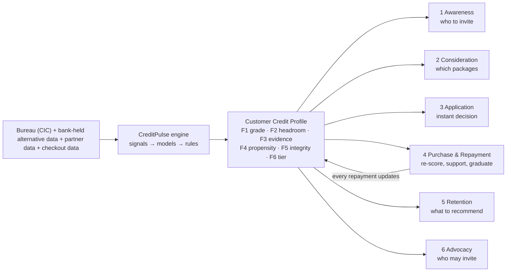

# HLB CreditPulse — How the Solution Works
### Product Solution Document: data in, assessment, outputs, and how every journey stage uses them
**Product:** HLB CreditPulse (Hong Leong Bank Vietnam, point-of-purchase lending) | **Version:** 1.0 | **Date:** 2026-10-02
**Context:** Business Challenge 2026, Ideation Round — *AI in Finance and Banking* (AI track)
**Built from:**
- [PRD](23-product-prd.md)
- [Credit Assessment Engine Design (13a)](../04-design/13a-credit-assessment-engine.md)
- [Solution Design (13)](../04-design/13-solution-design.md)
- Skills 01–22 of the product pipeline

> **How to read this document.** It explains, in plain language, how CreditPulse works end to end:
> - **§3** what data goes in;
> - **§4** how that data is assessed;
> - **§5** what comes out;
> - **§6** how each output drives the features at every stage of the customer journey;
> - **§7** worked walk-throughs;
> - **§8** a summary of how this solves the problems in the case.
>
> Engineers who need formulas, model specifications and parameters should use the 13a engine design; this document links to it throughout.
>
> **No invented numbers.** Figures come from the case brief `[Brief p.N]` or cited research. Every bank-specific threshold, limit or rate is a **named setting HLB chooses** (for example `policy.starter_limit_vnd`), never an assumed value. Walk-throughs (§7) use qualitative values ("high", "regular") for the same reason.

---

## 1. Summary

**The problem.** Hong Leong Bank Vietnam wants to lend at the point of purchase: instalment loans of 1.6M–90.1M VND over 3–24 months, offered at shops, e-commerce checkouts and merchant apps [Brief p.9]. Today every application goes through one manual, document-and-credit-bureau review. It costs **380,000 VND** and takes **1.8–4.6 business days** [Brief p.9]. As a result:
- the 44% of applicants who are gig workers, online merchants or first-time borrowers are mostly declined, even when they earn steadily [Brief pp.7–9];
- the answer arrives after the shopper has left [Brief p.4];
- small loans lose money on the review cost alone [Skill02 §2A].

**The solution.** **HLB CreditPulse** is one central assessment engine. For every customer and applicant, it reads:
- the bank's own records (account inflows, salary, bills, savings, card and loan history);
- the national credit bureau (CIC);
- partner data such as the Sổ Bán Hàng merchant sales ledger;
- a few checkout facts.

It combines all of this into one **Customer Credit Profile**: six answers about the customer, kept up to date. Every stage of the customer journey uses that same profile:
- to invite the right customers;
- to build affordable instalment offers;
- to decide **during checkout**;
- to learn from each repayment;
- to recommend suitable repeat purchases;
- to let loyal customers invite others safely.

**The result.**
- Decisions in minutes instead of days, with a target of p50 ≤ 3 minutes end-to-end.
- Human review only for genuinely uncertain cases.
- Fair approvals for people who earn but have no credit file.
- Built-in safeguards against over-lending, stacking and misuse of data [PRD §0, §4.6].

---

## 2. The problem in one picture

```
TODAY — one process for everyone [Brief pp.4–5, 9]

 Shopper at checkout ─► redirected to a branch-style application ─► uploads documents
   ─► officer checks the credit bureau + collateral ─► decision 1.8–4.6 business days later
   ─► 380,000 VND cost per application, whatever the loan size
   ─► shopper has already left: delays, abandons, or borrows informally
```

| Who is hurt | How | Evidence |
|---|---|---|
| Gig workers, online merchants, first-time borrowers (44% of applicants) | Judged on payslips and credit files they don't have, so they are declined despite real income | [Brief pp.7–8]; 31% can't or won't provide a labour contract, 33% a payslip [Skill03 S18] |
| Every applicant, including salaried customers with clean records | Waits days for an answer the bank could give instantly | [Brief p.9]; competitors decide in 5 s – 30 min [Skill02 F1] |
| HLB | Short, small loans lose money on review cost alone; for example a 3-month loan must be about 16.9M VND just to cover the review | [Skill02 §2A] |
| Shoppers generally | No targeted offers; fall back on informal "black credit" apps | [Brief pp.4, 6]; >200 illegal lending apps flagged by police [R37] |

**Root cause:** the decision **process** was built for branch lending and never redesigned. It is not that these customers are unscoreable [PRD §2].

---

## 3. What goes in: the input data `[Rubric R3]`

CreditPulse uses three families of data, always with the customer's consent for each purpose: scoring (SC), marketing (MK) and referral (RF) [PRD §4.1].

### 3.1 Bureau data: the national credit file (CIC)
| What it contains | What it tells us | Its limits |
|---|---|---|
| Existing loans and cards at all lenders, repayment history, days past due, recent credit enquiries | Whether the person already borrows, how much they owe each month, and whether they have paid on time | CIC covers **>70% of adults** (55.2M records), so roughly 3 in 10 adults have no file [R70]. CIC holds **no deposit or transaction data** [R71]. A thin or missing file says nothing about whether someone earns steadily |

CIC is **kept**, not replaced. Every successful lender studied blends the bureau with its own data [R13]. CreditPulse uses it in three places:
- the risk grade;
- monthly obligations, which feed affordability;
- the **anti-stacking check**, which stops loans piling up across lenders.

### 3.2 Alternative data the bank already holds (the core innovation)
The CIC cannot see deposits, so **HLB's own account data is information no bureau-only competitor has** [R71]. CreditPulse reads existing records as evidence of behaviour, instead of asking for documents [Skill13 §1.2]:

| Signal | Read from | What it reveals | Who it helps most |
|---|---|---|---|
| **Inflow regularity** | Current/savings account (CASA) credits over 6–12 months | Does money arrive every month, and how steady is it? Replaces the payslip | Salaried with no credit file; gig workers |
| **Salary-day stability** | Recurring credits from the same payer | A stable employer without a labour contract | Salaried with no credit file |
| **Cash cushion before payday** | Lowest balance before the main inflow | How tight the customer runs, a direct affordability signal | Everyone |
| **Platform-payout rhythm** | Credits from ride-hailing or delivery platforms | Weeks active and how consistent the gig income is | **Gig workers** |
| **Sales flow** | QR receipts, transfers, Sổ Bán Hàng sales, e-invoices | Business turnover, trend and refunds | **Online merchants** |
| **Bill-payment punctuality** | Utility, telco and school bills paid from the account | On-time habits (the brief names this signal [Brief p.8]) | **First-time borrowers** |
| **E-wallet top-up rhythm** | Transfers from the account to MoMo, ZaloPay and similar | Regular digital spending (named in the brief [Brief p.8]), seen from the bank's side | **First-time borrowers** |
| **Savings discipline** | Regular transfers to savings or term deposits | Planning and a buffer against shocks | Everyone |
| **Spending mix** | Card and QR spend by category | Essential vs discretionary spend; what they like to buy | Existing customers |
| **HLB credit conduct** | Existing HLB cards and loans | Internal track record | Existing customers |
| **Relationship stability** | Tenure, products held, recent contact changes | Stability; sudden changes before an application are a warning sign | Everyone |
| **App engagement** | HLB Connect usage | Used **only** to judge interest and the best channel, **never** risk, so less digital customers aren't penalised | — |

*Some signals depend on the bank's records showing who each payment came from or went to. That is confirmed by a data check (spike SP-1) before build [PRD §13.1].*

### 3.3 Data collected at checkout
| Data | Why |
|---|---|
| Chip ID card (CCCD) read by NFC + selfie liveness + face match (through HLB's existing national-ID integration, about 80 s) [R67] | Proves the applicant is who they claim to be, with no document uploads |
| One self-declared monthly income figure (new-to-bank applicants only; no proof requested) | Lets a first-time applicant be assessed for affordability. A safety haircut and cap are applied |
| Checkout facts: basket type, down-payment chosen, device type, time of day | Research shows such "digital footprint" signals predict repayment about as well as a credit-bureau score, and add to it [R80][L1] |

### 3.4 Data added in later phases
| Phase | Data | Condition |
|---|---|---|
| 2 | Transaction history from **other banks**, shared by the customer through Vietnam's Open API (Circular 64/2024) | HLB readiness; full compliance due 1 Mar 2027 [R73] |
| 3 | Telco, e-wallet or gig-platform data, directly or from scoring vendors | Only via the State Bank's Decree 94 sandbox and after legal checks on how vendors obtained the data [R74] |

### 3.5 What is never used
- Phone contacts, photo galleries, social media.
- Gender, ethnicity, religion or region as inputs. Gender, age band and region are used **only** to monitor fairness.
- "Was referred by a friend" as a reason to lower risk [PRD §4.2].

---

## 4. How the data is assessed `[Rubric R2][Rubric R3]`

### 4.1 Step 1: raw records become signals
Bank records are turned into **features**: measurable facts calculated as of the decision time, so the future never leaks into the past. Examples:
- months with income in the last 6;
- how much monthly income varies;
- the lowest balance before payday;
- the share of bills paid on time;
- weeks active on a delivery platform.

Each feature is registered with its definition, its data source and **whether it may be used for risk** [13a §3].

### 4.2 Step 2: the customer's evidence level is decided
Not everyone has the same amount of evidence, so CreditPulse first puts each person in one of four **evidence categories** [13a §4.3]:

| Evidence category | Meaning | Typical customer |
|---|---|---|
| **BUREAU+BANK** | Has a CIC file **and** enough account history at HLB | Salaried existing customer with loans or cards |
| **BANK-OBSERVED** | Enough HLB account history, no CIC file | Salaried, no credit history; gig worker paid into HLB |
| **CONSENTED-PARTNER** | Enough consented partner data (e.g. Sổ Bán Hàng sales) | Online merchant |
| **THIN** | Little observable history | New-to-bank first-time borrower; gig worker paid elsewhere |

The evidence category decides **which scoring model** applies and **how cautious** the first limit is.

### 4.3 Step 3: six assessments are produced (the Customer Credit Profile)
CreditPulse answers six questions about every customer. AI is used where research shows it beats simple rules; transparent rules are used where fairness and explainability matter more [PRD §3.2].

| # | Question | Output | How it's produced | AI or rules |
|---|---|---|---|---|
| **F1** | *How likely is this person to fall behind?* | **Risk grade A–E** (best → worst), from a calibrated probability of default | A points-based **scorecard** per evidence category (the main model). A **machine-learning challenger** (gradient-boosted trees with built-in logic limits) runs alongside on a random share of cases and takes over only where it proves better. First-time borrowers start on an **expert-designed scorecard** until real repayment data exists | **AI-assisted.** ML's advantage is largest for thin files [L4][L18] |
| **F2** | *How much can they safely repay each month?* | **Affordability headroom**: a VND/month amount | (1) **Estimate income** from the best evidence available: steady salary, irregular inflows with a safety haircut, merchant sales converted to income, or the declared figure (capped). (2) **Subtract** existing debts from CIC and HLB. (3) Take the lower of two safety limits: a debt-to-income cap, and income minus a living-cost buffer | **Rules**, with an AI income estimator where it proves more accurate |
| **F3** | *How much evidence do we have?* | **Evidence category** (four categories, §4.2) | Rules over which sources are present and consented | Rules |
| **F4** | *Would an offer genuinely help this person, and for what?* | **Suitability flag** plus likely purchase categories; later an **uplift score** | v1: suitability rules exclude anyone struggling, stacking loans, recently in hardship, or without marketing consent. Later an **uplift model** learns from a control group who *actually* takes up a good loan **because of** the offer | **AI** (uplift). Targeting purely on "who is likely to borrow" finds the riskiest people [R49] |
| **F5** | *Is this application genuine?* | **Integrity score 0–100** plus internal flags | Chip-ID and face checks, velocity checks (many applications from one device), recent contact-detail changes, an implausible declared income, plus an **anomaly detector** that spots unusual patterns | Rules + **AI** (anomaly detection) |
| **F6** | *What do we do?* | **Decision tier**: PRE-APPROVED · INSTANT APPROVE · REFER (to an officer) · DECLINE, plus **limit**, **counter-offer** and **reason codes** | A fixed, ordered **decision table** applied to F1–F5 (§4.4) | **Rules.** Transparent by design; the AI Law requires human oversight [Skill02 RF-8] |

**Why a hybrid, and not "AI everything".** Research shows most of the gain from alternative-data lending comes from **the data itself**, not the algorithm [L9]. So CreditPulse:
- uses AI only where it clearly adds value (thin-file risk, income estimation, targeting, re-scoring, fraud);
- keeps a transparent rules-based model running alongside;
- **measures** the AI's extra value on random splits and control groups.

That measurement is exactly what the competition asks for: proof of "clear, incremental value" [Brief pp.10–11].

### 4.4 Step 4: the decision table (how F1–F5 become an action)
The table is applied top to bottom; the first matching row decides [13a §4.6]. All thresholds are HLB settings.

| Order | If… | Then… |
|---|---|---|
| 1 | The identity or integrity check fails | **REFER** for identity review (or **DECLINE** if the mismatch is confirmed) |
| 2 | Existing debts can't be checked (CIC down, no recent copy) | **REFER** |
| 3 | Even the cheapest package exceeds affordability headroom | **DECLINE**, with a path ("smaller basket / larger down-payment") |
| 4 | CIC shows loans piling up | **REFER** if grade A/B, else **DECLINE** |
| 5 | Grade A/B with solid evidence (BUREAU+BANK, BANK-OBSERVED or CONSENTED-PARTNER) | **PRE-APPROVED** (existing customers) / **INSTANT APPROVE** (at checkout) |
| 6 | Grade A–C with THIN evidence | **INSTANT APPROVE at a starter limit** that grows with on-time repayment |
| 7 | THIN and borderline, chosen at random within a small, budgeted "learning corridor" | **INSTANT APPROVE at a starter limit**, flagged for learning |
| 8 | Grade C or D with solid evidence | **REFER** to an officer, with an immediate affordable **counter-offer** |
| 9 | Anything else | **DECLINE**, with reasons |

**How the limit is set.** The limit is the loan amount whose monthly instalment fits the headroom at the grade's interest rate and the chosen tenor. It is capped by the grade's maximum and the product maximum. Starter limits are lower. **No offer can ever exceed headroom.**

**Counter-offers.** For referred cases, the engine searches tenors (3–24 months) and down-payments for a smaller package that fits headroom, so the shopper can still buy now.

### 4.5 Step 5: every decision is explained
Each decision carries **reason codes**, the top factors that held the outcome back. Examples:
- "instalment exceeds what your income comfortably covers";
- "limited credit history";
- "approved at a starting limit that grows with on-time repayment".

They come from the scorecard's points (or the ML model's SHAP attributions [M1]), mapped to one shared catalogue. Customers see plain-language reasons with a next step. Merchants see only the status, and fraud signals are never disclosed [13a §6].

### 4.6 Step 6: the profile keeps updating
The profile is **refreshed**:
- on every repayment;
- when salary arrives;
- when CIC shows a new loan;
- when consent changes;
- nightly.

After a few instalments, a **behavioural grade** based on how the customer actually repays replaces the application grade. That makes repayment the strongest evidence a thin-file customer ever produces [13a §4.1.7].

### 4.7 How it learns, safely
| Mechanism | What it learns | Safeguard |
|---|---|---|
| **Learning corridor** (small, random, budgeted approvals of borderline thin-file applicants) | Whether "invisible" customers really repay, without guessing from who was declined [L20][L36] | Starter limits only; loss budget set by HLB; affordability rule still applies |
| **Champion/challenger** | Whether the ML model beats the scorecard, per segment | Takes over only with proof; reverts within 5 minutes on drift |
| **Control groups** for offers | Whether targeting really adds good loans | Control group never contacted |

---

## 5. What comes out: the Customer Credit Profile

```
CUSTOMER CREDIT PROFILE (one per customer, versioned, explainable)
 F1  Risk grade ................ A | B | C | D | E   (+ which model, model version)
 F2  Affordability headroom .... VND per month        (+ income estimate & how it was derived)
 F3  Evidence category ......... BUREAU+BANK | BANK-OBSERVED | CONSENTED-PARTNER | THIN
 F4  Propensity & need ......... suitable yes/no, likely categories (later: uplift score)
 F5  Integrity ................. 0–100 (+ internal flags, never shown to customers)
 F6  Decision tier ............. PRE-APPROVED | INSTANT APPROVE | REFER | DECLINE
                                 + limit, counter-offer, reason codes
```

Each stage reads **only the fields it needs**, and only for a purpose the customer consented to. A marketing feature, for example, cannot read the profile without marketing consent [PRD §4.4].

---

## 6. How the outputs power every stage of the customer journey `[Rubric R3]`



### Stage 1: Awareness, "find the right customers to invite"
- **Pain point solved:** HLB doesn't know which customers who have never used point-of-purchase lending are good, low-risk candidates, so offers are broadcast or not made at all [Brief p.6].
- **Features:**
  - nightly **target list**;
  - **suitability filter** with a **control group**;
  - **pre-approved limit** shown in the HLB Connect app;
  - later, an **uplift model** [PRD §4.4].

| Profile output used | How |
|---|---|
| F6 = PRE-APPROVED, limit | Only customers the bank would already approve are invited, with a real limit in the message |
| F1 grade A/B, F3 not THIN | Low-risk customers with solid evidence |
| F2 headroom ≥ cheapest package | No invitation someone can't afford |
| F4 suitability (later uplift) | Excludes anyone struggling or stacking loans; later targets people the offer **genuinely helps** |
| Consent check (MK) | Push messages only with marketing consent. Without it, the customer sees their limit only when they open the "Pay Later" tab themselves |

**Result:** a targeted, not broadcast, invitation. The control group measures real impact (KPI: extra take-up versus the control group).

### Stage 2: Consideration, "show offers that fit"
- **Pain point solved:** the customer is weighing options, and HLB offers no tailored package and no clear total cost [Brief p.4].
- **Features:** a **personalised package builder** (2–4 packages, tenors 3–24 months, down-payment options, 0% where the merchant subsidises it) and an **all-in cost display**.

| Profile output used | How |
|---|---|
| F1 grade | Sets the interest rate from a **published risk-tier rate grid**. Price depends on risk, never on willingness to pay |
| F2 headroom | Every package's instalment fits; packages that don't fit are never shown. Weekly instalments aligned to payout day are offered to gig and merchant customers |
| F6 limit | Maximum financed amount; larger baskets get down-payment or longer-tenor alternatives |

**Result:** the shopper compares affordable options and sees monthly amount, dates, **total payable**, APR and late-payment consequences before accepting (KPI: package acceptance; zero affordability breaches).

### Stage 3: Application & Instant Decision, "decide while they're still at the checkout"
- **Pain point solved:** the core bottleneck. Documents, redirects and a 1.8–4.6-day wait [Brief pp.4–6].
- **Features:**
  - in-session decision;
  - chip-ID + face verification (no uploads);
  - integrity check;
  - starter limit for thin files;
  - officer **refer band** with an instant counter-offer;
  - HLB account opening at approval;
  - fallback if the bureau is down;
  - merchant checkout options: embedded widget, HLB-hosted page, in-store QR.

| Profile output used | How |
|---|---|
| F5 integrity | Genuine applicant? Otherwise identity review |
| F1 + F3 | Which decision-table row applies (§4.4) |
| F2 | Final affordability gate and limit size |
| F6 tier + reason codes | Instant approve / refer / decline, with reasons; the merchant sees status only |

**Result:** existing customers are decided in **seconds**. New-to-bank applicants are decided within a target of **p50 ≤ 3 minutes end-to-end**, with the ID check (about 80 s) as the longest step [R67][Skill14 §2]. Only uncertain cases reach an officer, who sees all the evidence already assembled (KPIs: in-session decision rate ≥ 70%; officer review SLA; cost per decision).

### Stage 4: Purchase & Repayment, "keep reassessing and refining the profile"
- **Pain point solved:** the profile goes stale after the loan, and nothing learns from how the customer repays; struggling borrowers aren't spotted early [user requirement; Skill03 Pain #10–#11].
- **Features:**
  - **re-scoring on every repayment**;
  - **early-warning** triggers with supportive outreach;
  - **graduation offers** (higher limit, better rate) that the customer must accept;
  - reporting to CIC;
  - a **weekly repayment option** for gig and merchant customers;
  - **respectful collection** rules (never contacting relatives or references, sensible hours, approved messages).

| Profile output used | How |
|---|---|
| Repayment behaviour → F1 behavioural grade | On-time payers' grades improve; missed payments downgrade |
| F2 refreshed | Graduation only if affordability still holds |
| Early-warning flag | Pauses marketing and graduation; sends a supportive reminder |
| CIC stacking check | No step-up if loans are piling up elsewhere |

**Result:** good payers graduate ("my limit grows because I paid on time"), struggling payers get help early, and every loan builds a CIC history (KPIs: delinquency at month 3 within the ceiling; early-warning cure rate).

### Stage 5: Retention, "recommend suitable products to suitable users"
- **Pain point solved:** generic cross-selling annoys customers [Skill03 Pain #9], and good customers aren't offered relevant repeat purchases.
- **Features:**
  - up to 3 **recommendations** per week, matched to partner merchants' catalogues;
  - a **control group**;
  - an **anti-stacking gate**;
  - a "ready limit" view.

| Profile output used | How |
|---|---|
| F4 likely categories | What the customer tends to buy (spend mix, past purchases) |
| F2 headroom | Only items they can afford, with the instalment shown |
| F6 / stacking check | Suppressed if they're taking on debt elsewhere |
| Consent (MK) | Recommendations only with marketing consent |

**Result:** relevant, affordable suggestions rather than spam (KPIs: good-payer repeat rate, measured against the control group; stacking rate does not rise).

### Stage 6: Advocacy, "let loyal customers bring others in, safely"
- **Pain point solved:** growth through word of mouth, without pushing debt onto friends or harassing "reference" contacts, which is a documented harm in Vietnam [Skill03 Pain #8].
- **Features:**
  - **repayment-conditioned invite**: the inviter's reward unlocks only after the friend repays on time;
  - **refer-a-merchant** through Sổ Bán Hàng (Should);
  - **good-payer passport** (Should).

| Profile output used | How |
|---|---|
| F1 grade + on-time history | Only good payers can invite |
| Invitee's **own** profile | The friend is assessed independently. The inviter's data is never used, and "referred" never lowers risk [R61] |
| Repayment events | Release the reward only after the friend's on-time instalments |

**Result:** referral growth that rewards repayment, not borrowing. Research shows tying the reward to repayment improves repayment [R61] (KPI: referred customers' delinquency is no worse than others').

### Behind the scenes: the bank officer and the merchant
- **Credit officer:**
  - receives only REFER cases, each with the full profile, sources and reason codes;
  - decides within the SLA;
  - must give a justification for any override.

  This is how CreditPulse meets the AI Law's human-oversight requirement [Skill02 RF-8].
- **Merchant:**
  - integrates once (widget, hosted page or QR);
  - receives approve / refer / decline status in-session;
  - never sees personal data;
  - gains sales (offering instalments raises merchant sales by about 20% in published research [R57]).

### Feature-to-profile matrix

| Feature | F1 grade | F2 headroom | F3 evidence | F4 propensity | F5 integrity | F6 tier |
|---|:-:|:-:|:-:|:-:|:-:|:-:|
| Target list & pre-approval (Awareness) | ● | ● | ● | ● | | ● |
| Package builder & cost (Consideration) | ● | ● | | | | ● |
| Instant decision & eKYC (Application) | ● | ● | ● | | ● | ● |
| Starter limit & learning corridor | ● | ● | ● | | | ● |
| Officer refer band & counter-offer | ● | ● | ● | | ● | ● |
| Re-scoring, early warning, graduation (Repayment) | ● | ● | ● | | | ● |
| Weekly repayment option | | ● | ● | | | |
| Recommendations & anti-stacking (Retention) | | ● | | ● | | ● |
| Repayment-conditioned invite (Advocacy) | ● | | | | ● | ● |

---

## 7. Walk-throughs (qualitative; no real HLB figures)

### 7.1 Anh Hùng: ride-hailing driver, new to HLB (Lane B)
1. **At a phone shop**, he picks "Pay over time with HLB" and sees indicative packages with the total cost.
2. He gives consent for scoring, scans his chip ID (NFC) and takes a selfie, and types in his usual monthly income. No payslip is requested.
3. **Data in:**
   - CIC returns **no file**;
   - his platform pays into another bank, so HLB has no account history for him yet;
   - the checkout facts look normal;
   - the declared income is plausible.
4. **Assessment:**
   - F3 = **THIN**;
   - F1 from the expert-designed starter scorecard = grade **C**;
   - F2 = declared income × haircut, capped, minus CIC debts (none);
   - F5 = high (ID verified, no anomalies).
5. **Decision:** decision-table row 6 gives **INSTANT APPROVE at a starter limit**. The packages he sees all fit his headroom. A weekly option appears once his payout pattern becomes visible.
6. He signs with an OTP and the shop confirms. He's offered an HLB account to repay from. Accepting it means his income becomes **visible to the bank** over time.
7. **After a few months of on-time instalments,** his behavioural grade improves and his evidence becomes BANK-OBSERVED. He receives a **graduation offer**, which he must accept. CIC now holds a positive history for him.

### 7.2 An existing salaried HLB customer who has never used point-of-purchase credit (Lane A)
1. **Overnight:** regular salary inflows on a stable day, a healthy cushion before payday, and bills paid on time give F3 = **BANK-OBSERVED** and F1 = **A**. F2 leaves comfortable headroom; F4 = suitable.
2. **Decision:** row 5 gives **PRE-APPROVED** with a limit. If she has given marketing consent, she gets an in-app card saying she can pay over time up to her limit at partner stores. If not, she sees the limit only when she opens the "Pay Later" tab herself.
3. **At checkout:** she picks a package and confirms with a face check. Headroom and the stacking check are re-validated, and she is **INSTANT APPROVED in seconds**.

### 7.3 Chị Phụng: online seller using Sổ Bán Hàng
1. **Data in:** with her consent, 12 months of Sổ Bán Hàng sales, QR receipts and e-invoices; CIC shows one small loan, paid on time.
2. **Assessment:**
   - F3 = **CONSENTED-PARTNER**;
   - F1 from the merchant scorecard (steady sales, low refunds, rising trend) = **B**;
   - F2 = median sales × HLB's sales-to-income ratio, minus CIC debts.
3. **Decision:** row 5 gives **INSTANT APPROVE** for purchases at partner merchants.
4. **Later:** she can **suggest her supplier** join HLB's network through Sổ Bán Hàng (refer-a-merchant).

---

## 8. How CreditPulse solves the case problems

| Case requirement [Brief p.6] | How CreditPulse solves it | Measured by |
|---|---|---|
| **R-1** Assess creditworthiness beyond the bureau for young professionals, gig workers and online merchants | Bank-held behavioural signals (§3.2) the CIC doesn't hold; merchant sales data; evidence-tiered scorecards; starter limits; the learning corridor; current/savings-account onboarding turns "invisible" customers into observable ones | Thin-file approval rate within the delinquency ceiling; evidence-upgrade rate |
| **R-2** Decide within the purchase moment, at a cost proportional to the loan, keeping risk quality, responsible lending and compliance | Tiered decision: humans only for REFER cases; automated clear cases; in-session orchestration; affordability hard rule; anti-stacking; AI Law oversight; consent ledger | In-session rate ≥ 70%; p50 ≤ 3 min; blended cost per decision; delinquency at month 3 |
| **R-3** Verify identity and genuineness in real time, without document friction | Chip-ID NFC + liveness + face match (existing HLB rails); integrity score with anomaly detection; no uploads | Confirmed fraud rate; eKYC pass rate |
| **R-4** Target customers likely to need, accept and responsibly use credit, rather than broadcasting | Pre-approval list + suitability + control group; uplift model; recommendations capped by headroom | Extra take-up versus control group; complaint rate |
| **Your journey pain points** (awareness, packages, reassessment, recommendations, advocacy) | §6, stages 1, 2, 4, 5, 6 | Stage KPIs in §6 |

**Why it is commercially viable.** Decision cost scales with uncertainty, not with every application. A tiered engine brings the break-even ticket for a 3-month loan down from about 16.9M VND to roughly 2–7M VND. That range assumes a 10–40% officer-review share and a low automated cost; it is a sensitivity analysis, not a forecast [Skill09 §3.3]. HLB's cheaper deposit funding (sector cost of funds about 4.8%, against about 7.1% at a leading finance company) lets it price fairly [Skill02 F4].

---

## 9. Safeguards built in

| Risk | Safeguard |
|---|---|
| Over-lending, debt spirals | Headroom hard rule (no offer above it); anti-stacking at every draw; graduation offered, never automatic; early warning |
| Misuse of personal data | Consent recorded separately for scoring, marketing and referral; every profile read is logged; sensitive data handled under Vietnam's data-protection law (PDPL) and Decree 356; in-country hosting |
| Unfair outcomes | Protected attributes never used as inputs; monthly fairness monitoring; a challenger must pass fairness checks before taking over |
| Opaque "black-box" decisions | Reason codes on 100% of decisions; transparent rules for tiers and limits; officers oversee REFER cases; decisions can be replayed |
| Misleading 0% marketing | All-in cost and total payable shown before acceptance |
| Harassing collection | No reference contacts collected; contact hours and frequency limits; approved messages (VNBA code, 31 Mar 2026) |
| Model drift | Weekly drift monitoring; automatic fallback to the scorecard |

---

## 10. What it depends on

| Dependency | Why it matters | Status |
|---|---|---|
| AI Law conformity assessment **before launch** | Automated credit decisions are classed as high-risk | Start at the pre-build stage (PRD risk RK-01) |
| Bank record detail (who paid whom) | Enables several innovative signals | Data spike SP-1 |
| Real-time loan booking in core banking | "Order completes during checkout" | Spike SP-4 |
| HLB policy settings (grade cut-offs, limits, debt-to-income cap, corridor size and others) | Turn the design into decisions | Set by HLB's Chief Risk Officer |
| Partner merchants and Sổ Bán Hàng | Distribution and merchant data | Partnership |

Full lists: [PRD §13](23-product-prd.md) and [13a §11–12](../04-design/13a-credit-assessment-engine.md).

---

## 11. Glossary

| Term | Meaning |
|---|---|
| **CIC** | Vietnam's national Credit Information Centre (credit bureau) |
| **CASA** | Current and savings accounts |
| **Thin file** | A person with little or no credit-bureau history |
| **Customer Credit Profile (CCP)** | The six assessments CreditPulse keeps for each customer |
| **Headroom** | The largest new monthly instalment a customer can safely afford |
| **Scorecard** | A transparent points-based risk model (the main model) |
| **Challenger** | A machine-learning model tested against the scorecard on random cases |
| **Uplift** | How much an offer *changes* someone's behaviour, as opposed to whether they would have borrowed anyway |
| **REFER band** | Uncertain cases sent to a credit officer |
| **Learning corridor** | A small, budgeted set of random approvals used to learn about thin-file customers |
| **MOB3 30+** | A loan 30+ days late three months after booking (the delinquency guardrail) |

---

## 12. Sources

All facts trace to the case brief (`_requirements.md`) and the pipeline's per-skill source indexes. Key sources:
- **[R70][R71]** CIC coverage (55.2M records, >70% of adults); CIC holds no deposit data. https://sbv.gov.vn/en/w/cic-tong-ket-hoat-dong-2025 ; https://en.baochinhphu.vn/viet-nams-central-bank-confirms-credit-data-incident-at-credit-information-center-111250912192742851.htm
- **[R67]** HLB Vietnam eKYC (onboarding about 300 s → about 80 s). https://aapnews.aap.com.au/news/cision20260428AE45287
- **[R66]** HLB Vietnam × Sổ Bán Hàng. https://www.hlbank.com.vn/en/about-us/news-and-updates/hlb-partners-with-so-ban-hang.html
- **[R73][R74]** Circular 64/2024 (Open API); Decree 94/2025 (sandbox). See `_research-notes-07-13.md`
- **[R80][L1]** Berg et al. (RFS 2020), digital footprints vs bureau score. https://nber.org/papers/w24551
- **[L9]** Di Maggio, Ratnadiwakara & Carmichael, data vs algorithm in alternative-data lending. https://www.nber.org/papers/w29840
- **[L4][L18]** Gambacorta et al. (2024); Lessmann et al. (2015), ML vs scorecards. See `literature-review.md`
- **[L20][L36]** Reject inference limits; randomised credit access. See `literature-review.md`
- **[R49]** Agarwal et al., propensity vs risk. https://www.nber.org/system/files/working_papers/w21567/w21567.pdf
- **[R57]** Keil, Berg, Burg & Puri (JFE 2025), BNPL +~20% merchant sales. https://nber.org/system/files/working_papers/w33152/w33152.pdf
- **[R61]** Bryan, Karlan & Zinman, repayment-conditioned referrals. https://www.nber.org/papers/w17883
- **[M1]** Lundberg & Lee (2017), SHAP. https://dl.acm.org/doi/10.5555/3295222.3295230
- **[Skill02], [Skill03], [Skill09], [Skill14]**: market, user, unit-economics and feasibility research in the pipeline files
